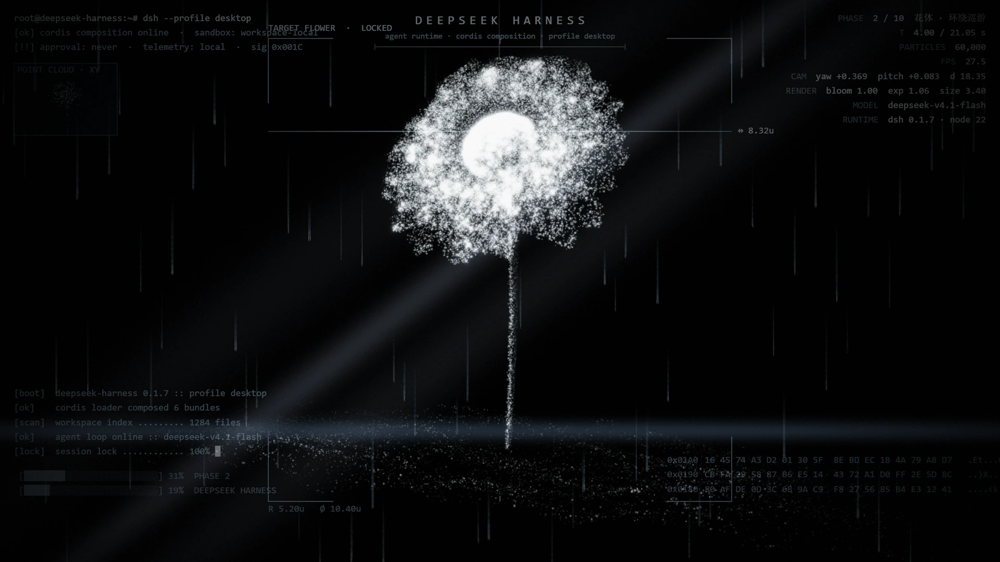
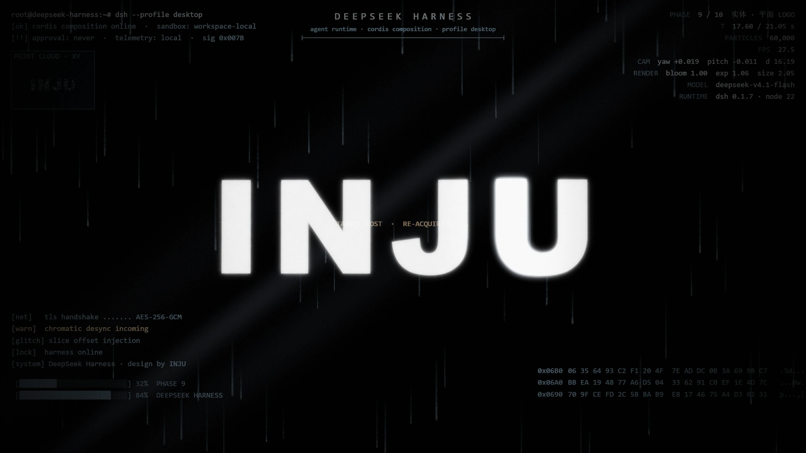

<div align="center">


# dsh-inju-boot · INJU 启动动画

**给 DeepSeek Harness 装一支开机动画。**
每次启动 Harness，全屏播放一支 WebGL2 实时粒子动画 —— 花 → 月球 → 虚影文字 → 实体 LOGO，
带一套极客 HUD / 终端层和 Apple 发布会式的程序化音效，播完自动淡出把界面交还给你。

[](https://github.com/inju0524/dsh-inju-boot/actions/workflows/test.yml)
[](LICENSE)
[](package.json)
[](package.json)

[快速开始](#快速开始) · [设置项](#设置项) · [工作原理](#工作原理) · [自检](#自检) · [排障](#排障) · [English](#english)

</div>



---

## 这是什么

一个 DeepSeek Harness 插件（bundle），给 Web 界面加两样东西：

| | |
|---|---|
| **启动覆盖层** | 挂在 `shell.overlay`，页面一加载就全屏播放动画，播到设定位置后淡出 |
| **设置页** | 挂在 `settings.section`，与宿主其它设置页并排，动画的一切参数都在这里调 |

动画本体是一支**零依赖的单文件 WebGL2 作品**：6 万颗自发光粒子、10 个阶段、程序化生成的
3D 雏菊 / 粒子月球 / 虚影文字 / 实体 LOGO，外加一层画在画布内、会跟着一起吃泛光与像素偏移闪切的
**极客 HUD**（数字雨、跟随主体的目标框、扫描线、实时点云小图、终端日志、遥测、hex dump）。

它还带了 **DeepSeek Harness 的产品身份层**：顶部逐字拉开的 `DEEPSEEK HARNESS` 铭牌、
左上角的 `root@deepseek-harness:~# dsh --profile desktop`、遥测里的 `MODEL` / `RUNTIME` 字段、
以及一整套 DSH 启动序列的终端日志。

<p align="center">
  
  <br>
  <sub>第 09 阶段 · 实体平面 LOGO —— 极客 HUD 全程都在，跟着粒子一起吃泛光与像素偏移闪切</sub>
</p>

```
y=  27  root@deepseek-harness:~# dsh --profile desktop          PHASE   2 / 10  花体 · 环绕巡游
y=  29                    D E E P S E E K   H A R N E S S
y=  55  [ok] cordis composition online · sandbox: workspace-local          2.00 / 21.05 s
y=  63        agent runtime · cordis composition · profile desktop
y=  83  [!!] approval: never · telemetry: local · sig 0x000E              60,000
y= 194  MODEL    deepseek-v4.1-flash
y= 222  RUNTIME  dsh 0.1.7 · node 22
y= 296  TARGET FLOWER · LOCKED
y= 804  [boot]  deepseek-harness 0.1.7 :: profile desktop
y= 935  [███░░░░░░░░░░░░░░░░░░░░░░░] 10%  DEEPSEEK HARNESS
```

> 上面是 `node tools/check-animation.mjs --dump` 打出来的**真实绘制调用**（1920×1080，t=2.0s）。
> 想看你自己屏幕尺寸下的排版：`node tools/check-animation.mjs --dump --w=1440 --h=900 --t=9.5`

<details>
<summary>预览图是怎么来的（想自己重新生成的话）</summary>

动画自带**静帧模式**：`?t=<秒>` 定格在指定时刻并暂停，`hud=0` 隐藏页面 DOM 装饰、`telemetry=1` 保留极客 HUD。
插件把动画挂在 `/api/inju-boot/boot.html`，所以只要 Harness 在跑，直接用浏览器打开这个地址就能截图：

```
http://127.0.0.1:19387/api/inju-boot/boot.html?t=4.0&hud=0&telemetry=1     # 花体阶段
http://127.0.0.1:19387/api/inju-boot/boot.html?t=10.5&hud=0&telemetry=1    # 月球阶段
http://127.0.0.1:19387/api/inju-boot/boot.html?t=17.6&hud=0&telemetry=1    # 实体 LOGO
```

`docs/` 里的两张预览图就是这样抓的（headless Edge + CDP，等 90 帧后 `Page.captureScreenshot`，
再转成 WebP）。**注意别加 `--disable-frame-rate-limit --disable-gpu-vsync`** —— 那两个开关会让
`requestAnimationFrame` 的 dt 趋近 0，而 HUD 是每 1/30 秒才重绘一次，结果就是截到一张没有 HUD 的干净画面。

</details>

---

## 快速开始

### 安装

**方式 A：交给 Harness 自己装（推荐）**

让 Harness 里的 Agent 调用 `plugin_manager`：

```
plugin_manager action=install_bundle target=<这个仓库的绝对路径>
```

它会替你写 profile 的 `package.json` / `cordis.patch.yml` 并完成安装 —— **不要手改那两个文件**。

**方式 B：dsh CLI**

```powershell
dsh --profile <你的 profile> plugin add "file:<这个仓库的绝对路径>"
# 或直接从 GitHub 装：
dsh --profile <你的 profile> plugin add "github:inju0524/dsh-inju-boot"
```

装完**重启一次 Harness**（新增 bundle 需要重新组装 profile）。下一次启动就会看到动画。

> 卸载：`plugin_manager action=remove_bundle target=dsh-inju-boot`
> 只是不想看了：设置页关掉「启用启动动画」，或在 `cordis.patch.yml` 里给这一行加 `disabled: true`。

### 动画从哪来

插件按这个顺序找动画：

1. **设置页里显式填的「动画目录」**（填到含 `inju-particles.html` 的目录）
2. **插件的上一级目录** —— 把这个插件文件夹放进你自己的动画项目里，它就用那份**活的**动画，
   你在 `inju.config.js` 里改一个数字，刷新页面就生效
3. **插件自带的 `assets/` 副本** —— 独立 clone 出来时用这份，保证任何机器上都能播

---

## 设置项

设置 → **INJU 启动动画**。

| 分组 | 项 | 说明 |
|---|---|---|
| 播放 | 启用启动动画 | 总开关 |
| | 每次启动只播一次 | 会话级去重，开发时热重载不会反复重播 |
| | 时长倍率 | 等比拉伸整条时间轴（>1 更慢） |
| | 结束阶段 | 播到第几个阶段末尾就淡出（默认播完整个循环） |
| | 淡出时长 | 结束时的淡出毫秒数 |
| 背景音乐 | 背景音乐 / 音效 | **是否播放背景音乐**。关掉时连引擎都不加载（`?audio=0`） |
| | 背景音乐音量 | 0~1，覆盖动画配置里的 `audio.master` |
| | 首次点击只解锁声音 | 默认开。第一次点击/按键只用来出声，**不中断动画** |
| | 自动播放被拦下时提示 | 只在浏览器确实拦下自动播放时才出现 |
| 跳过 | 点击中断动画 | 是否允许**点击**中断动画 |
| | 按键中断动画 | 是否允许**按键**中断动画（Esc 始终可跳过） |
| | 显示跳过按钮 / 按钮文字 | 右下角的跳过按钮 |
| 画面 | LOGO / 虚影文字 | 虚影文字与最终实体 LOGO 都用它 |
| | 粒子数量 | 1000 ~ 400000 |
| | 粒子尺寸 / 粒子亮度 / 泛光强度 / 机距 | 直通动画的 `size` / `intensity` / `bloom` / `dist` |
| | 极客 HUD / 终端层 | **可选，默认开启**。DSH 铭牌与启动命令行 + 数字雨 + 目标框 + 扫描线 + 点云小图 + 终端日志 + 遥测 + hex dump |
| | 模式 | `flower3d` 程序化 3D 雏菊 / `photo` 照片粒子化 |
| 窗口顶栏 | 顶栏融入动画 | **默认开启**。仅 Windows 桌面端：让最小化/最大化/关闭背后的标题栏背景变透明 |
| | 隐藏「应用 / 编辑」菜单 | **默认开启**。仅 Windows 桌面端：动画期间隐藏 Desktop 注入的菜单条，播完恢复 |
| 高级 | 动画目录 | 留空 = 自动探测 |
| | HUD 终端台词 | 一行一条 `秒 文本`；`{text}` 会换成真正的 LOGO 文字 |
| | `inju.config.js` 覆盖 | 一段 JSON，**深度合并**到动画目录那份 `inju.config.js` 之上 |

配置落在 `<DSH_HOME>/inju-boot/config.json`（默认 `~/.dsh/inju-boot/config.json`），
`cordis.patch.yml` 里那一行的 `config` 是出厂种子。三层优先级：
**内置默认值 ← YAML 种子 ← config.json（设置页写这里）**。

### 「`inju.config.js` 覆盖」能改什么

动画配置的**全部**字段，键名与 `inju.config.js` 完全一致：

```json
{
  "camera": { "orbitYaw": 0.6, "dist": 20 },
  "moon":   { "radius": 2.6, "craters": 110 },
  "flower": { "layers": [ { "n": 40, "len": 2.4 } ] },
  "render": { "bloom": 1.2, "exposure": 1.1 },
  "hud":    { "brand": { "title": "MY HARNESS", "subtitle": "我的启动序列" } },
  "stages": [ { "dur": 3.2 }, { "dur": 4.0 } ]
}
```

`stages` 数组**按下标合并**，只写想改的那几项就够了。

---

## 工作原理

### 一、动画托管：原文件一个字节都不改

`inju-particles.html` 里 `<script src="inju.config.js">` 是相对路径，所以当 Host 把动画挂在
`/api/inju-boot/boot.html` 时，浏览器会去取 `/api/inju-boot/inju.config.js` —— 而这条路由返回的是
**运行时合成**的配置：

```
动画目录的 inju.config.js   ←   插件 advanced 覆盖   ←   时间轴倍率
```

Host 用 `node:vm` 在沙箱里取出动画目录那份配置对象（纯字面量，无副作用），深合并后序列化成
`window.INJU_CONFIG = {...}`。所以你既可以直接改项目里的 `inju.config.js`，也可以在设置页叠加覆盖，
互不打架。**动画本体和它的配置都是按请求现读的，改完刷新页面即生效，不用重启 Harness。**

Host 半身在 `ctx.inject(['webServer'], …)` 里注册 7 条 `exact` 路由，全部挂在 `ctx.effect` 上，卸载即回收：

| 路由 | 作用 |
|---|---|
| `GET/POST /api/inju-boot/config` | 读 / 写配置（`replace: true` 整份替换，`reset: true` 回出厂） |
| `GET /api/inju-boot/boot.html` | 动画本体（原文件原样吐出，供覆盖层 iframe 使用） |
| `GET /api/inju-boot/inju.config.js` | 运行时合成的 `window.INJU_CONFIG` |
| `GET /api/inju-boot/inju-audio.js` | 音效引擎 |
| `GET /api/inju-boot/inju-particles.html` | 原文件（想单独打开看的时候用） |
| `GET /api/inju-boot/asset?name=…` | 动画目录里的其它资源（白名单扩展名 + 拒绝任何跨目录/绝对路径） |
| `GET /api/inju-boot/preview-url` | 覆盖层 iframe 的查询串 |

### 二、背景音乐怎么做到自动播放

「必须点一下才有声音，但一点动画就没了」是**两个原因叠在一起**：

1. **动画的音频引擎不会自己启动。** `inju-audio.js` 的 `init()`（里面才 `new AudioContext()`）
   **只从 `unlock()` 调用**，而 `unlock()` 只挂在动画自己窗口的首次 `pointerdown`/`keydown` 上。
   所以哪怕浏览器策略再宽松，没人推它一把它也永远不出声。
2. **那一下点击同时又命中了跳过规则**，动画当场结束。

覆盖层的解法：

1. **主动解锁。** iframe 与宿主同源，覆盖层在 iframe 的 `load` 事件里直接调用
   `iframe.contentWindow.INJU_AUDIO.unlock()`。DSH Desktop 是 Electron，默认
   `autoplayPolicy = no-user-gesture-required`，所以**这一步之后不需要任何点击，音乐直接响**。
2. **第一次手势只解锁声音。** 普通浏览器会把 AudioContext 挂起，这时必须有一次真实手势。
   开启「首次点击只解锁声音」后，**第一次**点击/按键被吃掉（只用来出声），动画继续播；
   从**第二次**起才按「点击中断动画 / 按键中断动画」走。
3. **只在真的被拦下时才提示。** 覆盖层新建一个 AudioContext 探它是 `running` 还是 `suspended`
   （自动播放策略按**顶层文档**判定，同源 iframe 与之共享），只有 `suspended` 才在底部显示
   「点一下画面开启声音（这次点击不会中断动画）」。
4. 每次手势都会**再推一次** `unlock()`（幂等），所以引擎晚一点就绪也接得上。

### 三、Windows 顶栏：为什么它一开始会「压」在动画上

这不是调大 z-index 能解决的 —— 两处漏点各有各的原因：

**① 左上角「应用 / 编辑」菜单条（DOM）。**
Desktop 的 preload 往 `body` 上注入了一个 `div[data-windows-menu]`（内含 shadow root），
`position: fixed; z-index: 1100`。而 `shell.overlay` 的条目渲染在
`.BynINW_overlayLayer{position: absolute; z-index: 20}` 里 —— **那是一个层叠上下文**，
所以覆盖层写多大的 z-index 都只在 `20` 这一层里有效，必然被 `1100` 压住。
→ 解法：动画期间 `display: none` 掉它，播完移除样式自动恢复。

**② 右上角最小化 / 最大化 / 关闭（原生 Window Controls Overlay）。**
这三个按钮由 Chromium 画在网页内容**之上**，CSS 碰不到按钮本身。但它们的**背景色是可变的**：
preload 里有个探针元素用 `background-color: var(--dsw-specific-sidebar-fill)` 量出色值，
再经 `windowsAppearance` IPC 调 `mainWindow.setTitleBarOverlay()`。而主进程的校验是
`/^(?:#[\da-f]{3,8}|rgba?\([\d.,%\s]+\))$/` —— **8 位 hex 和 rgba 都接受**。
→ 解法：动画期间把 `--dsw-specific-sidebar-fill` 置为 `transparent`，原生顶栏背景就变成
`rgba(0, 0, 0, 0)`，动画从三个按钮后面透出来；DOM 里那条 40px 标题栏
（`.BynINW_frame::before`）用的是同一个变量，一起透明。顺带把 `--dsw-alias-label-primary`
（原生按钮的符号色）按**覆盖层底色**算成亮/暗，保证按钮在动画上看得清。

这个 `<style>` 必须挂在 **`document.head`**：preload 的 MutationObserver 只观察 head 的
childList/subtree，挂在别处不会触发它重新量色。它是本插件唯一一次「组件之外的 DOM 写入」，
所以每条退出路径（正常播完 / 超时 / 卡住 / 组件卸载）都会把它移除，不会留下一个透明顶栏。

### 四、覆盖层怎么知道「播完了」

它**不去猜时长**，而是读动画**自己的进度条** `#scrub` —— 那是动画公开的播放头
（`value = T/TOTAL*1000`）。总时长来自 Host 算好的 `resolved.stages`，所以「结束阶段」选到第几秒是精确的。
另外还有三层兜底：文档 8 秒没起来、进度一直停在 0 超过 20 秒、以及 `maxDurationMs` 硬上限 ——
任何意外都不会让覆盖层永久挡住界面。

> **为什么用 iframe**：动画本身是一支自带全局 CSS（`html,body{overflow:hidden}`）和 WebGL2
> 上下文的独立作品，直接塞进 React 树会污染宿主页面的全局样式。iframe 把它隔离成一个独立
> artwork 文档。设置页则是纯 React + `--dsw-alias-*` 主题令牌，与宿主其它设置页同构。

---

## 自检

**零依赖，不需要 Harness、不需要浏览器**（CI 也跑这三套）：

```powershell
npm test                        # 三套一起跑
node tools/selftest.mjs         # Host 半身：84 项
node tools/selftest-client.mjs  # 浏览器半身：62 项
node tools/check-animation.mjs  # 动画本体：38 项
node tools/check-animation.mjs --dump --w=1440 --h=900 --t=9.5   # 打出 HUD 排版
```

| 套件 | 验什么 |
|---|---|
| `selftest.mjs` | 起一个真 http 服务跑 7 条路由：配置读 / 写 / 整份替换 / 复位、路径穿越防护、越界输入收敛、动画目录解析、`inju.config.js` 合成、身份层下发 |
| `selftest-client.mjs` | 把 `client.js` 当真正的 bundle 加载：ModuleLoader 契约、插槽注册、音频桥、首次手势策略、顶栏处理、源码卫生（只允许主题令牌、不 import 宿主 Client 包、不往 body 追加节点） |
| `check-animation.mjs` | 内联脚本语法；**把 `hudDraw()` 抽出来配一个会记账的假 2D 上下文真跑一遍**，断言铭牌/命令行/遥测字段/进度条产品名/DSH 日志真的被画出来、标题居中且带字距、1920/1280/640 三种宽度下都不越界 |

**在线（对着正在运行的 Harness 打真实请求）**：

```powershell
node tools/selftest-live.mjs                    # 默认 http://127.0.0.1:19387
node tools/selftest-live.mjs http://127.0.0.1:19387
```

40 项：Host 路由在线、动画本体与音效可被浏览器取到、**服务出去的 `inju.config.js` 能真的跑出
`window.INJU_CONFIG` 且合并正确**、极客 HUD 与音频开关都真的接通了、bundle 解析链、profile 的 bundles 列表。

`tools/` 里还有三个**只读**的 asar 工具，用来翻 DSH 自带文档与源码（这个插件的顶栏那一段就是靠它们查出来的）：

```powershell
node tools/asar-list.mjs    "<...>/resources/app.asar" windows-titlebar
node tools/asar-extract.mjs "<...>/resources/app.asar" "lib/preload-app.cjs" ./out
node tools/asar-grep.mjs    "<...>/resources/app.asar" "app-region" --ext .js
```

---

## 排障

| 现象 | 原因 / 处理 |
|---|---|
| 启动没动画 | 设置页看「当前生效」那一行：`✗` 表示没找到动画目录，把「动画目录」填成含 `inju-particles.html` 的目录 |
| 设置页打不开 / 列表里没有入口 | Host 半身没挂上：确认 profile 的 `dsh.profile.bundles` 里有 `dsh-inju-boot`，然后重启 Harness |
| 画面干净但**没有极客 HUD** | 「极客 HUD / 终端层」被关掉了（默认开），打开它 |
| 想开 HUD 但看不到台词 | 台词在「HUD 终端台词」里，逐行 `秒 文本`；清空就不显示日志 |
| **完全没有声音** | ①「背景音乐」是不是被关了；② 音量是不是拉到 0；③ 普通浏览器下需要**先有一次点击**（第一次点击只解锁声音、不会中断动画，覆盖层会在底部提示你）；④ 桌面端正常应自动出声 |
| **点一下就中断了动画** | 关掉「点击中断动画」；若想保留它又要点一下出声，确认「首次点击只解锁声音」是**开**的 |
| 左上角「应用 / 编辑」压在动画上 | 开「隐藏「应用 / 编辑」菜单」 |
| 右上角三个按钮背后有一条色带 | 开「顶栏融入动画」。若无效，可能是自定义主题绕过了 `--dsw-specific-sidebar-fill` |
| 动画结束后顶栏颜色没还原 | 不该发生；插件在播完 / 超时 / 卸载时都会移除那个 `<style>`。真遇到刷新页面即可 |
| 动画在播但界面被挡住很久 | 把「结束阶段」调到 09，或把「时长倍率」调小；Esc / 点击 / 任意键都能跳过 |
| 想把铭牌换成自己的 | 「`inju.config.js` 覆盖」里写 `{"hud":{"brand":{"title":"…","subtitle":"…"},"shell":"…"}}` |
| 想改回出厂 | 设置页「恢复出厂默认」，或删掉 `<DSH_HOME>/inju-boot/config.json` |

---

## 目录

```
dsh-inju-boot/
├── package.json            # 包清单：dsh.bundle.patch + dsh.client(platform=web, immediately)
├── cordis.patch.yml        # profile 层：insert 一行把 Host 半身挂上去（config 是出厂种子）
├── index.js                # Host 半身：配置 + /api/inju-boot/* 路由（零依赖，只用 node: 内建模块）
├── client.js               # 浏览器半身：启动覆盖层（音频桥 / 顶栏处理）+ 设置页（手写 ModuleLoader bundle）
├── icon.svg                # 插件图标
├── locale/{zh,en}.json     # 展示文案
├── docs/                   # README 预览图（WebP）
├── assets/                 # 动画副本（独立 clone 时的兜底；放在动画项目里则走项目那份）
├── tools/                  # 三套自检 + 三个只读 asar 工具
└── .github/workflows/      # CI：push / PR 自动跑三套自检
```

### 依赖与兼容

- **零运行时依赖**：Host 半身只用 `node:` 内建模块；浏览器半身只用 shell 已经提供的 `react`。
  不 import 任何 `@deepseek-ai/*` 运行时包 —— 那一层 API 面会漂移，能不依赖就不依赖。
- 插件挂载用 `ctx.inject(['webServer'], …)`，插槽用 `ctx.slots.inject(...)`（等插槽出现才注册），
  所以宿主缺这些能力时是**安静地不激活**，而不是启动报错。
- 顶栏那两项只在 **Windows 桌面端**有效（靠 preload 打的 `data-windows-titlebar` 标记）；
  macOS 的窗口本来就透明，浏览器里根本没有这些元素，开了也是空操作。

### 验证边界（说实话）

三套离线自检 + 一套在线自检共 **224 项断言**，覆盖的是**契约与绘制调用**，不是截图。
动画那一套会把真正的 `hudDraw()` 抽出来、配一个会记账的假 2D 上下文跑一遍，
断言每个元素真的被画了出来、位置与居中对不对、窄窗口会不会越界 —— 这是没有浏览器时能拿到的最强证据。
但字体的真实字宽与假上下文的估算（0.6em）可能有几个百分点出入，
所以 640px 那种极限宽度下「缩字号 vs 不画」的边界可能略有偏移（两侧预留是按实测宽度算的，不会重叠）。

---

## 素材与许可

- 代码：[MIT](LICENSE) © inju0524
- 动画本体（`inju-particles.html` / `inju-audio.js` / `inju.config.js`）与内嵌照片（`assets/flower.jpg`）
  为本项目自有素材，随本仓库一并以 MIT 分发；照片请勿单独转载。

---

## English

**dsh-inju-boot** is a DeepSeek Harness plugin that plays a full-screen WebGL2 particle startup
animation every time Harness launches — a procedural 3D daisy blooms, collapses into a particle moon,
resolves into ghost text and snaps into a solid logo, with a geek HUD/terminal layer (digital rain,
target lock box, scanline, live point cloud, terminal log, telemetry, hex dump) and a programmatically
synthesised Apple-keynote-style soundtrack.

- **Zero dependencies.** The Host half uses only `node:` built-ins; the browser half only uses the
  `react` the shell already provides. No `@deepseek-ai/*` runtime imports.
- **Everything is configurable** in Settings → *INJU 启动动画*: text, particle count, size, bloom,
  brightness, camera distance, playback speed, end stage, fade-out, skip behaviour, background music
  and volume, HUD on/off, the DSH nameplate / terminal lines, and a free-form deep-merge override of
  the animation's own `inju.config.js`.
- **The animation file is never modified.** The Host composes `window.INJU_CONFIG` at request time by
  merging the animation project's own config with your overrides.
- **Background music autoplays** on the desktop app: the overlay proactively calls the animation's
  `INJU_AUDIO.unlock()` (the engine only builds its `AudioContext` there). The *first* click/keypress is
  consumed to unlock audio and no longer dismisses the animation.
- **The Windows titlebar blends into the animation.** The native min/max/close background colour is
  driven by `--dsw-specific-sidebar-fill` (the preload probes it and pushes it over IPC to
  `setTitleBarOverlay`), so the plugin sets it to `transparent` while playing; the injected
  *Application / Edit* menu bar (`div[data-windows-menu]`, `z-index: 1100`) is hidden for the duration.

```powershell
# install (let the Harness agent do it):
plugin_manager action=install_bundle target=<absolute path to this repo>
# or with the CLI:
dsh --profile <profile> plugin add "github:inju0524/dsh-inju-boot"
```

Then restart Harness. Tests need neither Harness nor a browser: `npm test` runs 184 assertions across
three suites, and `node tools/check-animation.mjs --dump` prints the real HUD draw calls as a layout map.
